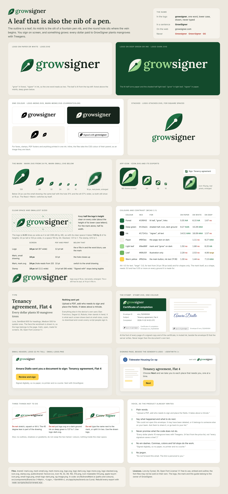

# growsigner brand kit



`guide.png` is drawn from `guide.html` by `scripts/build-brand.mjs`. The logo concept that was chosen, and the three that were not, stay in `concepts/` as they were (they were drawn under the working name "growsigning", and are kept as drawn).

## The name

The product is called GrowSigner, to match its domain, growsigner.com.

| Where | Write it | |
|---|---|---|
| In the logo | **growsigner** | one word, lower case, always the drawn logo, never typed in a font |
| In a sentence, a title, an email | **GrowSigner** | "Sent with GrowSigner." |
| Never | Growsigner, Grow Signer, GS, GROWSIGNER | |

## The idea

A leaf that is also the nib of a fountain pen: the midrib is the slit of the nib, and the round hole sits where the vein begins. You sign on screen, and something grows, because every dollar paid to GrowSigner plants mangroves with Treegens.

## The files, and which to use where

All in `brand/` unless said. Every SVG has its letters as paths, a `<title>`, no transforms, and a viewBox that ends at the ink, so a logo set 22 px tall is 22 px of logo. The marks sit on a 64 unit icon grid, the leaf filling the middle 56.

| File | What it is | Use it for |
|---|---|---|
| `logo.svg` | mark and word, for light grounds | paper, white, light photos |
| `logo-dark.svg` | the same for dark grounds | deep green `#134a2c`, ink `#17241c`, dark photos |
| `logo-mono.svg` | one colour (`currentColor`) | faxes, stamps, one-ink print, anywhere two greens will not print |
| `logo-stacked.svg` | mark above the word | square spaces: a profile picture, a slide's title page, a poster |
| `mark.svg` | the leaf alone, two greens | 24 px and up, where the name is already written nearby |
| `mark-small.svg` | the leaf with the nib opened wider | 16 to 23 px |
| `mark-mono.svg` | the leaf alone, one colour | buttons, bullets, small one-colour places |
| `icon.svg` | the app icon: the small drawing on a deep green tile | the browser tab, the home screen (and the source of every icon PNG) |
| `stamp.svg` | "Signed with growsigner" in a ruled box, one colour | the certificate, the foot of signed copies |
| `public/brand/favicon.ico` | 16, 32 and 48 px in one file | `/favicon.ico` |
| `public/brand/icon-16.png`, `-32`, `-48` | the tile | browsers that do not take SVG |
| `public/brand/icon-192.png`, `-512` | the tile, transparent corners | the web app manifest |
| `public/brand/icon-maskable-512.png` | full bleed, leaf inside the 80% safe circle | the manifest, `purpose: maskable` (Android) |
| `public/brand/apple-touch-icon.png` | 180 px, no transparency, iOS rounds it | iPhone and iPad home screens |
| `public/brand/email-logo.png` | the logo 22 px tall at 2x (266 by 44), transparent | email headers, as `width="133" height="22"` |
| `public/brand/email-logo-dark.png` | the same for dark email | an email client's dark mode, if a `<picture>` is used |
| `public/brand/og-image.png` | 1200 by 630, the logo and one line on paper | link previews |
| `src/lib/brandMark.ts` | the paths and colours as strings | drawing the logo into a PDF, or inline |
| `src/components/Brand.tsx` | `<Mark>`, `<Logo>`, `<SentWith>` | every logo in the app |
| `src/app/styles/brand.css` | Lora and the `--serif` stack | the headings |

The OG line is "Sign on screen. Every dollar plants mangroves." It says what the price list says (10 mangroves for every dollar paid), and nothing about signing alone planting trees, because a free account's signatures do not.

## Clear space and smallest sizes

Keep **half the logo's height** clear on every side; that is about the height of its lower case letters. For the mark alone, half its width. For the stamp, its ruled box is the edge; keep a quarter of its height clear around it.

The proportions, from the viewBoxes:

| | Width to height | Example |
|---|---|---|
| `logo.svg`, `-dark`, `-mono` (290.48 by 48) | **6.05 to 1** | 22 px tall is 133 px wide; with its clear space it takes 155 by 44 |
| The logo with its clear space | **7.05 to 2** | a space 2 h tall and 7.05 h wide for a logo h tall |
| `logo-stacked.svg` (233.24 by 154.7) | **1.51 to 1** | 200 px tall is 302 px wide |
| `stamp.svg` (245.82 by 40) | **6.15 to 1** | 14 pt tall is 86 pt wide |

Measured by drawing each file at 1x from 10 px up and looking at the pixels (the logo and the small drawing are enlarged at 16 px in `guide.png`):

| | Smallest on screen | In a PDF or print | What goes first below that |
|---|---|---|---|
| Logo | **16 px** tall (97 px wide) | 12 pt tall | the eye of the e fills in at 14 px and the word blurs; use the mark |
| Mark, small drawing (`mark-small.svg`, the icon) | **16 px** | 10 pt | the hole closes up; at 14 px only the slit is left |
| Mark, `mark.svg` | **24 px**; its hole still reads at 20 px | 10 pt | switch to the small drawing |
| Stamp | **18 px** tall (111 px wide) | 14 pt tall | "Signed with" stops being legible |

So the nib still reads at 16 px, in the small drawing. `<Mark>` switches to it by itself below 24 px.

## Colours

| | Hex | For | On paper | On white | On deep green |
|---|---|---|---|---|---|
| Forest | `#1f6f43` | the lit half of the mark, "grow", links | 5.55 | 6.15 | 1.67 |
| Deep green | `#134a2c` | the shaded half, the icon tile, dark grounds, the app's side bar | 9.27 | 10.28 | |
| Ink | `#17241c` | "signer", all text | 14.51 | 16.09 | 1.57 |
| Paper | `#f6f3ec` | the page; text and the lit half on dark | | 1.11 | 9.27 |
| Light leaf | `#9ed88f` | the mark and "grow" on dark grounds | 1.50 | 1.66 | 6.20 |
| Leaf | `#6fb35f` | illustration only, never text | 2.29 | 2.53 | 4.06 |
| Warm yellow | `#ffd24a` | the main button only, with ink text (11.16) | 1.30 | 1.44 | 7.13 |

Contrast ratios by the WCAG 2.1 formula. AA asks 4.5 for text and 3.0 for large text (24 px, or 19 px bold) and for shapes.

- **Pass AA as text:** ink, deep green and forest on paper and on white; paper, white, light leaf and yellow on deep green; ink on yellow. Deep green and ink on paper or white also pass AAA (7.0).
- **Large text and shapes only:** leaf on deep green (4.06), forest on yellow (4.27).
- **Never for text:** leaf on paper or white, light leaf on paper or white, yellow on paper or white, forest or ink on deep green.
- The mark is a shape and needs 3.0. Each of its halves has 5.55 or more against every ground it is made for (the lowest is forest on paper).

## Type

- **Lora** (Cyreal), SemiBold 600 for headings and Medium 500 for quieter ones. The wordmark is Lora SemiBold, outlined, so headings set in Lora make the logo part of the page instead of a sticker on it. It is a calm book serif made for screens, with open shapes that hold up at heading sizes on a phone. Package `@fontsource/lora` **5.3.0** (Lora version 3.008), pinned. `scripts/copy-assets.mjs` copies the Latin 500 and 600 files to `public/fonts/lora-500.woff2` and `lora-600.woff2` on install; `src/app/styles/brand.css` loads them with `font-display: swap` and puts Lora first in `--serif`, ahead of the stack the app used before.
- **The device's own sans** for everything else (`--sans`: San Francisco, Segoe UI, Roboto and so on). It is what each screen draws best at small sizes, costs no download, and already covers every script people sign in.
- The wordmark is never typed in Lora as text. It is always the drawn logo, which has three tightened pairs that typed text does not: r and o by 6, w and s by 10, and e and r by 8 thousandths of an em, on top of Lora's own kerning.

## The stamp

`stamp.svg`: the mark, "Signed with" in Lora Medium Italic and the wordmark, in a ruled box, one colour. It goes at the foot of the certificate and of every page of a signed copy, in muted ink (`rgb(0.42, 0.47, 0.44)` in `pdf.ts`), beside the envelope ID that the server writes. Never larger than the document's own text: 14 pt tall is right for a PDF.

## Things not to do

Three of these are drawn in `guide.png`.

- Do not stretch, squash, tilt or rotate it. The 45 degree lean is part of the drawing.
- Do not put `logo.svg` on a dark ground (ink on deep green is 1.57 to 1). Use `logo-dark.svg`.
- Do not type the name next to the mark, in any font, or split it into two words. Use the drawn logo.
- Do not swap the two halves' colours, recolour "grow" and "signer", or add outlines, shadows or gradients.
- Do not put anything inside the clear space, and do not use the full colour logo on a busy photo.

## Voice

Five rules, taken from how the product already writes.

1. **Plain words.** "Upload a PDF, add who needs to sign and place the fields. It takes about a minute."
2. **Say what happened and what to do next.** "We could not open this envelope. It may have been deleted, or it belongs to someone else on your team. Ask them to share it, or go back to your list."
3. **Never promise what the code does not do.** "Every dollar plants 10 mangrove trees with Treegens" is a number from the price list. "Every signature saves a tree" is not true, so it is never written.
4. **No em dashes.** Commas, colons and full stops do the work. "Signed digitally, so no paper, no printer and no courier."
5. **No jargon.** "Do not forward this email. The link is personal to you."

## What changed from the concept, and why

The concept is kept as drawn, with two changes, both for small sizes.

1. **The app icon's nib is opened wider, and its leaf is larger on the tile.** At 16 px the concept icon's slit was under a pixel wide and its hole about two, so the browser tab showed a plain leaf. In `icon.svg` the hole is 31% wider (radius 7.1 instead of 5.4 on the 64 grid) and the slit 57% wider where it meets the hole, and the leaf fills 50 of the tile's 64 units instead of 44. The tab icon now shows a dark slit and a dark hole. The outline of the leaf is unchanged. A bolder version was tried and left out: it read well at 16 px but looked heavy at 180.
2. **The same small drawing is offered as `mark-small.svg`**, and `<Mark>` uses it below 24 px, for the same reason.

Not changed: the leaf's outline, the hole's place, the slit's taper, the 45 degree lean, the wordmark's drawing (Lora SemiBold 600 at the concept's size and spacing, with the concept's two kerning tightenings), the lockup's proportions and the colours. The paths were rebuilt from numbers (the outline's curves, a circle and a two-part slit) instead of copied, and checked by laying them over the concept: they match. They now draw the hole as curves instead of arcs, and the one colour files cut the nib out with a contour that runs the other way, so every path fills correctly under both fill rules, including pdf-lib's.

## The rename, from growsigning to growsigner

The concepts were drawn under the working name "growsigning". The owner bought growsigner.com and named the product to match, so the kit was redrawn for the new word. What changed, and what did not:

- **The word.** "growsigner" is set exactly as "growsigning" was: Lora SemiBold 600 outlined, 44 units on the logo's 48, the ink starting 9.24 units after the mark's square, the top of the i's dot level with the top of the mark, "grow" in forest and "signer" in ink (light leaf and paper on dark). The mark, the icon and every icon PNG are unchanged.
- **Kerning.** r and o (by 6) and w and s (by 10) are kept: the letters around them are the same, and at 200 px r against o still needs it under the r's arm, while w and s look right with it. **e and r is new, tightened by 8.** Measured as the white between the letters over the x-height, Lora sets e and r 7 to 10 units looser than the other pairs in "signer" (n and e, s and i, i and g), and at 200 px it shows as a gap before the last letter. n and e, i and g and s and i are even with each other and are left alone; g and n is a little open, as it was in "growsigning", because the g's ear fills the top of the gap, and it is left alone too, to match g and r in "grow". At 22 px each of these moves is under a fifth of a pixel: they change how the word looks large, not whether it reads small.
- **The proportions.** The logo was 313.85 by 48 (6.54 to 1) and is now 290.48 by 48 (**6.05 to 1**); stacked was 256.61 by 154.7 and is now 233.24 by 154.7 (1.51 to 1); the stamp was 255.38 by 40 and is now 245.82 by 40. The email logo is 266 by 44 (was 288). The clear space rule (half the height) and the smallest sizes are unchanged: the letters are the same height, and the logo still reads at 16 px. Below that it is now the e, not the n and i, that fills in first.

## Licences

- **Lora**: copyright 2011 The Lora Project Authors, by Cyreal, SIL Open Font License 1.1. The outlines in the logo and the font files served from `public/fonts` are both allowed by it; the font files may not be sold on their own. The licence is in `node_modules/@fontsource/lora/LICENSE`.
- **The logo, the mark, the icon, the stamp and this guide** belong to the owner of GrowSigner.

## Rebuilding

```sh
node scripts/build-brand.mjs            # every PNG, favicon.ico and guide.png, from the SVG files here
node scripts/build-brand.mjs --masters  # first redraw the SVG files and src/lib/brandMark.ts from the drawing in the script
```

The first is what to run after editing an SVG. It needs Playwright with Chromium (installed on this machine), takes a few seconds, and refreshes the copies in `src/app/` named below once they exist. `--masters` is only for changing the drawing itself (the nib, the lockup's spacing, the stamp): it overwrites every SVG here, so an SVG edited by hand would be lost. It needs `@fontsource/lora` installed.

## Wiring it in

What to change in the rename pass. Nothing here is wired yet. Line numbers are as of 20 November 2026 and will drift; the code quoted is what to look for.

### 1. Fonts and styles: `src/app/layout.tsx`

- Add `import './styles/brand.css';` after the other style imports (it must come after `globals.css` so its `--serif` wins).
- Run `node scripts/copy-assets.mjs` once (every `npm install` runs it too) so `public/fonts/lora-500.woff2` and `lora-600.woff2` exist; `public/fonts` is not in git. `brand.css` also sets `.serif { font-weight: 600 }`, so headings stop asking for a bold that is not loaded.

### 2. Icons and the link preview: `src/app/` (Next's file conventions)

Copy four files into `src/app/`, then delete the `icons:` line (the data URI leaf) from `metadata` in `layout.tsx`. Next then writes the `<link>` and `<meta>` tags itself, with a hash in each URL so browsers notice a new icon.

| Copy | To | Next adds |
|---|---|---|
| `public/brand/favicon.ico` | `src/app/favicon.ico` | `/favicon.ico` |
| `brand/icon.svg` | `src/app/icon.svg` | `<link rel="icon" type="image/svg+xml">` |
| `public/brand/apple-touch-icon.png` | `src/app/apple-icon.png` | `<link rel="apple-touch-icon">` |
| `public/brand/og-image.png` | `src/app/opengraph-image.png` | `og:image`, 1200 by 630 |

Also add `src/app/opengraph-image.alt.txt` with `GrowSigner: sign on screen. Every dollar plants mangroves.` and, in `metadata`, `metadataBase: new URL(process.env.APP_URL || 'http://localhost:3000')` (so the preview's URL is absolute) and `twitter: { card: 'summary_large_image' }`. After that, `node scripts/build-brand.mjs` keeps these four copies up to date.

### 3. Theme colour: `src/app/layout.tsx`

`viewport.themeColor` is already `'#134a2c'`, the deep green. Keep it.

### 4. Web app manifest: new `src/app/manifest.ts`

There is none today. To let people add the app to a home screen:

```ts
import type { MetadataRoute } from 'next';

export default function manifest(): MetadataRoute.Manifest {
  return {
    name: 'GrowSigner',
    short_name: 'GrowSigner',
    start_url: '/app',
    display: 'standalone',
    background_color: '#f6f3ec',
    theme_color: '#134a2c',
    icons: [
      { src: '/brand/icon-192.png', sizes: '192x192', type: 'image/png' },
      { src: '/brand/icon-512.png', sizes: '512x512', type: 'image/png' },
      { src: '/brand/icon-maskable-512.png', sizes: '512x512', type: 'image/png', purpose: 'maskable' },
    ],
  };
}
```

### 5. Every `<Leaf>` used as the logo

Import from `@/components/Brand`. Each of these is a `<Leaf>` followed by the words "Sign&Grow"; the logo replaces both.

| File | Now | Put |
|---|---|---|
| `src/components/AppShell.tsx` (~96), phone top bar on deep green | `<Leaf color="#9ed88f" /> Sign&Grow` | `<Logo height={20} tone="dark" />` |
| `src/components/AppShell.tsx` (~103), side bar `.brand` on deep green | `<Leaf color="#9ed88f" size={22} /> Sign&Grow` | `<Logo height={24} tone="dark" />` |
| `src/components/AuthForm.tsx` (~83), sign in and sign up | `<Leaf color="#1f6f43" size={24} /> Sign&Grow` | `<Logo height={26} />` |
| `src/components/Public.tsx` (~43), public header | `<Leaf color="#1f6f43" size={24} /> Sign&Grow` | `<Logo height={26} />` |
| `src/components/Public.tsx` (~73), public footer | `<Leaf color="#1f6f43" size={20} /> Sign&Grow` | `<Logo height={22} />` |
| `src/components/HandedOver.tsx` (~34) | `<Leaf color="#1f6f43" /> Sign&Grow` | `<Logo height={22} />` |
| `src/components/sign/parts.tsx` (~81), signing bar, when the sender has no logo | `<Leaf size={22} color="#9ed88f" />` | `<Mark size={24} tone={brand?.brand_color ? 'mono' : 'dark'} />`. The bar takes the sender's colour, and `mono` follows the ink the page picks for it (`--sg-bar-ink`). |
| `src/components/sign/parts.tsx` (~91), signing page footer | `<Leaf size={14} color="#1f6f43" /> Powered by Sign&Grow` | `<SentWith height={16} />` |
| `src/app/f/[slug]/page.tsx` (~38), public form, when the sender has no logo | `<Leaf color="#1f6f43" size={24} />` | `<Mark size={28} />` |

These other `<Leaf>`s are pictures of a leaf next to a paper saving, not the logo. They can stay, or become `<Mark size={...} label="" />` so the old leaf shape does not sit beside the new one (`label=""` hides it from screen readers): `sign/parts.tsx` `Impact` (~128), `editor/StepReview.tsx` (~211), `app/app/envelopes/[id]/page.tsx` (~247), `app/app/settings/page.tsx` `.plan-hero` on deep green (~498, use `tone="dark"`), `app/app/page.tsx` empty state (~119), `app/page.tsx` "6 sheets saved" (~103). Once none is left, the `Leaf` export in `src/components/ui.tsx` can go.

### 6. Email header: `src/server/mail.ts`, `renderMail()`

The `logo` constant shows the sender's logo, else the sender's name, else the words "Sign&Grow". Keep the first two and replace the third with the image:

```ts
const logo = m.brand?.logo?.startsWith('data:image/')
  ? ``
  : m.brand?.name
    ? `<span style="font-size:18px;font-weight:700;color:${color}">${esc(m.brand.name)}</span>`
    : ``;
```

The image loads from `APP_URL`, so it shows once the app is public; until then mail clients show the alt text, "GrowSigner". The footer's "Sent with Sign&amp;Grow" becomes "Sent with GrowSigner" in the text pass.

### 7. The certificate and signed copies: `src/server/pdf.ts`

Add `import { LOGO, STAMP, TONES, COLORS, rgb01 } from '../lib/brandMark.ts';`. All three snippets below were run against pdf-lib and drawn with pdftoppm, the last one on pages rotated 0, 90 and 270 degrees.

**Certificate header**, in `drawCertificate()`: replace the band, the `drawSvgPath('M0 22 C0 8 ...')` leaf, the title and the "Sign&Grow · e-signatures that plant trees" line with:

```ts
s.page.drawRectangle({ x: 0, y: s.H - 92, width: s.W, height: 92, color: rgb(...rgb01(COLORS.deep)) });
const ls = 24 / LOGO.height; // the logo 24 pt tall
const parts = [[LOGO.mark.lit, 'lit'], [LOGO.mark.shade, 'shade'], [LOGO.grow, 'grow'], [LOGO.signer, 'signer']] as const;
for (const [d, part] of parts) s.page.drawSvgPath(d, { x: s.L, y: s.H - 22, scale: ls, color: rgb(...rgb01(TONES.dark[part])) });
s.page.drawText('Certificate of Completion', { x: s.L, y: s.H - 74, size: 20, font: ctx.bold, color: rgb(1, 1, 1) });
```

**Certificate and notice page footer**, in `Sheet.add()`: the stamp, then the footer text on its baseline. Drop "Sign&Grow · " from the footer strings passed to `Sheet` (in `drawCertificate`, `withNotice` and `renderEnvelopePdf`), since the stamp says it.

```ts
const ss = 14 / STAMP.height; // 14 pt tall
this.page.drawSvgPath(STAMP.d, { x: this.L, y: 36, scale: ss, color: MUTED });
this.page.drawText(this.footer, { x: this.L + STAMP.width * ss + 8, y: 26.8, size: 7, font: this.font, color: MUTED });
```

**Foot of every page of a signed copy**, in `renderEnvelopePdf()`, in the `for (const page of pages)` loop beside the "Envelope ID" line (which sits at the top of the page):

```ts
const sh = 14, sc = sh / STAMP.height;
const o = m.pt(12, m.H - 8 - sh); // the stamp's top left corner as the page is shown, 8 pt above its bottom edge
page.drawSvgPath(STAMP.d, { x: o.x, y: o.y, scale: sc, rotate: m.rotate, color: MUTED });
```

The rest of `pdf.ts` is text: "Signed via Sign&Grow" under each signature, "Sign&Grow Envelope ID", `setProducer` and `setCreator`.

### 8. The words

"Sign&Grow" (or `Sign&amp;Grow`) appears 315 times in 78 files under `src/` (counted on 20 November 2026, while the app was being worked on, so expect more), plus the README, the `.env.example` and `MAIL_FROM`. That is the text pass, and each one becomes "GrowSigner". Two comments in files outside this kit still say "growsigning": the first line of `src/app/styles/brand.css` and the Lora note in `scripts/copy-assets.mjs`; they become "growsigner" in the same pass.
